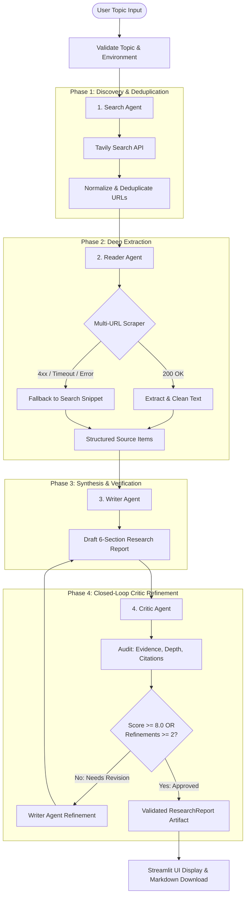

# ResearchMind – AI-Powered Multi-Agent Research System

[](https://streamlit.io/)
[](https://python.org)
[](https://groq.com)
[](https://langchain.com)
[](https://pydantic.dev)
[](LICENSE)

**ResearchMind** is an enterprise-grade multi-agent research and synthesis engine. It automates the end-to-end investigation workflow: discovering diverse web sources, deep-reading and extracting content, synthesizing structured academic-style reports, and conducting rigorous, critic-guided revisions with bounded iterative refinement.

Built with **Streamlit**, **Groq LPU Inference**, **LangChain**, and **Tavily Search**, ResearchMind guarantees evidence-grounded research without fabricated citations or unverified assertions.

---

## 📌 Problem Statement

Traditional single-prompt LLM generation faces significant hurdles when tasked with in-depth research:
1. **Hallucinated Citations**: LLMs frequently invent non-existent URLs and authors.
2. **Single-Source Bias**: Models rely on superficial search snippets rather than deep-reading multiple authoritative primary sources.
3. **No Quality Feedback Loop**: Standard generation outputs a single draft without reviewing weaknesses, missing context, or unsupported claims.
4. **Fragile Web Scraping**: Broken links, timeouts, or paywalls frequently crash monolithic pipelines.

**ResearchMind** solves these challenges by decoupling the research process into four specialized autonomous agents governed by closed-loop critic evaluation and Pydantic schema validation.

---

## 🚀 Key Features

* **Multi-Source Discovery & URL Deduplication**: Discovers diverse web sources and strips tracking query parameters (`utm_*`), fragments, and redundant trailing slashes to eliminate duplicate scrapes.
* **Fault-Tolerant Deep Web Scraping**: Deep-reads 3–5 candidate URLs with custom timeouts and HTML cleanup. Inaccessible websites (404s, timeouts, access barriers) fail gracefully to search snippets without crashing the pipeline.
* **Standardized 6-Section Academic Reports**: Produces strictly structured reports containing:
  1. *Executive Summary*
  2. *Introduction*
  3. *Key Findings* (minimum 3 well-explained points)
  4. *Detailed Analysis* (explicitly distinguishes verified evidence from model synthesis)
  5. *Conclusion*
  6. *References* (grounded solely in discovered URLs; zero hallucinated citations)
* **Closed-Loop Critic Refinement (Max 2 Attempts)**: An independent Critic Agent audits drafts for missing information, weak explanations, and unsupported claims. If score < 8.0/10, actionable feedback is routed back to the Writer Agent. Strictly bounded to 2 refinement attempts to prevent infinite loops.
* **Pydantic v2 Schema Validation**: Validates all sources, reports, and critic evaluations against strict type schemas, supplemented by resilient fallback parsers for malformed LLM outputs.
* **Cloud & Local Dual Configuration**: Supports both local `.env` setups and Streamlit Community Cloud `st.secrets` without hardcoded credentials.
* **Modern Streamlit Interface**: Offers real-time agent execution progress, source status inspection, Markdown export, and a custom dark/light aesthetic.

---

## 🏗️ System Architecture



---

## 🤖 Multi-Agent Workflow Responsibilities

| Agent | Core Responsibility | Input | Output Artifact |
| :--- | :--- | :--- | :--- |
| **Search Agent** | Broad exploration and identification of high-authority web resources | Research Topic string | Deduplicated candidate URLs, titles, and snippets |
| **Reader Agent** | Content extraction and resilient scraping across 3–5 unique URLs | Candidate source list | `List[SourceItem]` with clean text or snippet fallbacks |
| **Writer Agent** | Structured report drafting adhering strictly to grounded source evidence | Topic + `List[SourceItem]` (+ optional Critic feedback) | `ResearchReport` Pydantic model (6 verified sections) |
| **Critic Agent** | Rigorous evaluation of factual support, completeness, and reasoning depth | Topic + `ResearchReport` + `List[SourceItem]` | `CriticEvaluation` Pydantic model (Score, Audit, Verdict) |

---

## 🛠️ Tech Stack

* **Language**: Python 3.10+
* **LLM Provider**: [Groq](https://groq.com) (Default: `openai/gpt-oss-120b`)
* **Orchestration**: [LangChain](https://www.langchain.com/) & `langchain-groq`
* **Search Tool**: [Tavily Search API](https://tavily.com/) (`tavily-python`)
* **Data Validation**: [Pydantic v2](https://pydantic.dev/)
* **Web Scraping & Parsing**: `requests`, `beautifulsoup4`, `lxml`
* **Frontend UI**: [Streamlit](https://streamlit.io/)
* **Secrets Management**: `python-dotenv` (local) and `st.secrets` (Streamlit Community Cloud)

---

## 📂 Project Structure

```
multi-agent-system/
├── .streamlit/
│   └── config.toml          # Streamlit theme and headless server configuration
├── .env.example             # Template for required environment variables (safe to commit)
├── .gitignore               # Excludes secrets (.env, secrets.toml), virtualenvs, cache
├── agents.py                # Agent definitions (Search, Reader, Writer, Critic) & factory methods
├── app.py                   # Streamlit web application & UI presentation layer
├── models.py                # Pydantic v2 schemas (SourceItem, ResearchReport, CriticEvaluation)
├── pipeline.py              # Orchestration engine & single source of truth for pipeline execution
├── requirements.txt         # Cleaned, lightweight production dependencies
├── test_system.py           # Comprehensive automated unit & integration test suite
└── tools.py                 # Tavily search, URL normalization, fault-tolerant scraping, sanitization
```

---

## ⚡ Getting Started (Local Setup)

### 1. Prerequisites
* Python 3.10, 3.11, or 3.12 installed on your system.
* A [Groq API Key](https://console.groq.com/keys) (Free tier available).
* A [Tavily Search API Key](https://app.tavily.com) (Free tier available).

### 2. Clone Repository
```bash
git clone https://github.com/Ashijain30/Multi-agent-system.git
cd Multi-agent-system
```

### 3. Create and Activate Virtual Environment
```bash
# Windows
python -m venv .venv
.\.venv\Scripts\activate

# macOS / Linux
python3 -m venv .venv
source .venv/bin/activate
```

### 4. Install Dependencies
```bash
pip install -r requirements.txt
```

### 5. Configure Environment Variables
Copy the example environment template:
```bash
cp .env.example .env
```
Open `.env` and insert your actual API keys:
```ini
GROQ_API_KEY=gsk_your_actual_groq_api_key_here
TAVILY_API_KEY=tvly-your_actual_tavily_api_key_here
GROQ_MODEL=openai/gpt-oss-120b
```
*(Note: `.env` is listed in `.gitignore` and will never be committed to Git.)*

---

## 🖥️ Running Locally

### Launch the Streamlit Web Application
```bash
streamlit run app.py
```
Open your browser at `http://localhost:8501`.

### Run via Command-Line Interface (CLI)
You can also execute the orchestration pipeline directly in headless terminal mode:
```bash
python pipeline.py
```

### Run the Automated Test Suite
Execute the 9-point unit and integration test suite:
```bash
python test_system.py
```

---

## ☁️ Deployment Guide (Streamlit Community Cloud)

Follow these steps to deploy ResearchMind publicly on **Streamlit Community Cloud**:

1. **Push your code to GitHub**:
   Ensure all changes are committed and pushed to your GitHub repository:
   ```bash
   git add .
   git commit -m "Prepare ResearchMind for production deployment"
   git push origin main
   ```
   *(Verify that your `.env` file is NOT staged or committed.)*

2. **Sign in to Streamlit Community Cloud**:
   Go to [share.streamlit.io](https://share.streamlit.io) and log in with your GitHub account.

3. **Deploy New App**:
   * Click **New app**.
   * Select your repository: `Ashijain30/Multi-agent-system`.
   * Branch: `main`.
   * Main file path: `app.py`.

4. **Configure Secrets in Streamlit Cloud Dashboard**:
   Before launching, click **Advanced settings...** (or go to App Settings → Secrets after creation) and enter your API keys in TOML format:
   ```toml
   GROQ_API_KEY = "gsk_your_actual_groq_key"
   TAVILY_API_KEY = "tvly_your_actual_tavily_key"
   GROQ_MODEL = "openai/gpt-oss-120b"
   ```
   *Streamlit Cloud injects these securely into `st.secrets` without exposing them in source code.*

5. **Deploy**:
   Click **Deploy!**. Streamlit Cloud will install dependencies from `requirements.txt` and launch the application.

---

## 📝 Example Output

### Sample Input
> **Topic:** `CRISPR gene editing clinical breakthroughs in 2025`

### Sample Generated Report Structure
```markdown
# Research Report: CRISPR gene editing clinical breakthroughs in 2025

## Executive Summary
In 2025, therapeutic gene editing transitioned from ex-vivo cell manipulation 
to systemic, targeted in-vivo base and prime editing...

## Introduction
Since the discovery of Cas9, precision genetic medicine has pursued systemic 
delivery without causing double-strand DNA breaks...

## Key Findings
1. Targeted Lipid Nanoparticles (LNPs): Demonstrated organ-selective tropism beyond the liver.
2. In-Vivo Base Editing: Phase II human trials validated over 85% target gene silencing.
3. Harmonized Global Regulations: Joint FDA/EMA framework for off-target verification.

## Detailed Analysis
Empirical clinical trial data indicates high therapeutic efficacy. In contrast, 
model synthesis highlights that manufacturing scale and cost-of-goods remain the primary barriers...

## Conclusion
The clinical developments of 2025 mark a milestone in curing monogenic diseases...

## References
- <https://example.com/clinical-trial-crispr-2025>
- <https://example.com/gene-editing-delivery-review>
```

### Sample Critic Evaluation
```markdown
### Evaluation Score: **8.5 / 10** ([Approved])

**Verdict:** Comprehensive, rigorous analysis with verified references and clear epistemic distinctions.

#### Strengths
- Clear distinction between clinical trial facts and synthesis
- Robust citation of discovered primary URLs
- Deep coverage of lipid nanoparticle delivery mechanisms
```

---

## 📸 Screenshots

*(To attach UI screenshots to your repository, capture your running application and place images in an `assets/` directory, e.g., `assets/researchmind_ui.png`.)*

```
+------------------------------------------------------------------------------+
| 🔬 ResearchMind · AI Research Agent                                          |
|                                                                              |
| Research Topic: [ CRISPR gene editing breakthroughs in 2025 ] [⚡ Run Pipeline] |
|                                                                              |
| [01 Search Agent ✓]  [02 Reader Agent ✓]  [03 Writer Agent ✓]  [04 Critic ✓] |
|                                                                              |
| 📚 Collected Multi-Source References (5 sources · 4 scraped)                 |
| 📝 Final Research Report (6 Verified Sections with Markdown Download)       |
| 🧐 Critic Audit: Quality Score 8.5/10 · Status: Approved                     |
+------------------------------------------------------------------------------+
```

---

## 🔮 Future Roadmap

* [ ] **PDF & LaTeX Export**: Direct compilation of generated reports into publication-ready PDF formats.
* [ ] **Domain-Specific Scrapers**: Native scrapers for ArXiv, PubMed, and IEEE Xplore APIs.
* [ ] **Human-in-the-Loop Mode**: Interactive step allowing users to manually review and deselect URLs before scraping.
* [ ] **Session History**: Local SQLite / IndexedDB session caching for historical research comparison.

---

## 📄 License

This project is licensed under the MIT License — see the [LICENSE](LICENSE) file for details.

